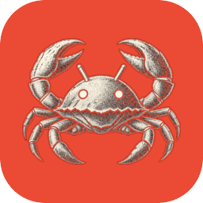
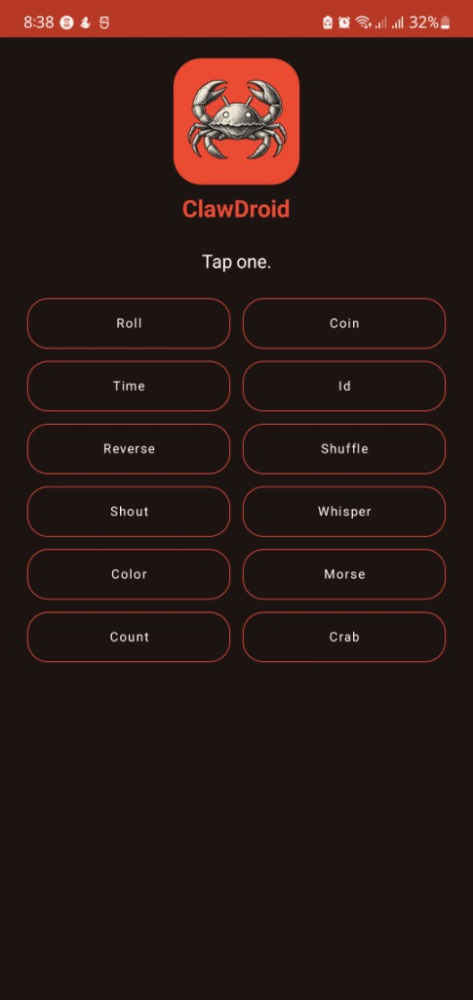

# ClawDroid

<p align="center">
  
</p>

ClawDroid is a cargo-generate template for a Java Android app with a Rust library.

## Generate a project

```sh
cargo install cargo-generate
curl -fsSL -L https://github.com/Kiojeen/clawdroid/archive/refs/tags/v1.0.2.tar.gz | tar -xz
cargo generate --allow-commands --path clawdroid-1.0.2
```

You choose a folder name, an app name, a package name, a library name, and Java or Kotlin. The defaults are `my-rust-app`, `ClawDroid`, `com.example.clawdroid`, `clawdroid`, and `java`. The library file is `lib<name>.so`. You also choose ABIs and a minSdk. Space toggles an ABI and enter confirms. `arm64-v8a`, `armeabi-v7a`, `x86_64`, and `x86` start selected. minSdk can be 24, 26, 28, 33, or 34, and 24 is the default. Git repo defaults to yes.

<p align="center">
  
</p>

## Libraries

- Android Gradle Plugin 8.13.2
- Kotlin 2.0.21, when you choose Kotlin
- Gradle 8.13
- RustJNI 0.1.0
- jni 0.21
- AndroidX AppCompat 1.7.1
- Material Components 1.13.0
- ConstraintLayout 2.2.1
- JUnit 4.13.2
- AndroidX JUnit 1.2.1
- Espresso 3.6.1

`compileSdk` and `targetSdk` are 37. Gradle runs on JDK 17.

## License

MIT. See [LICENSE](LICENSE).
